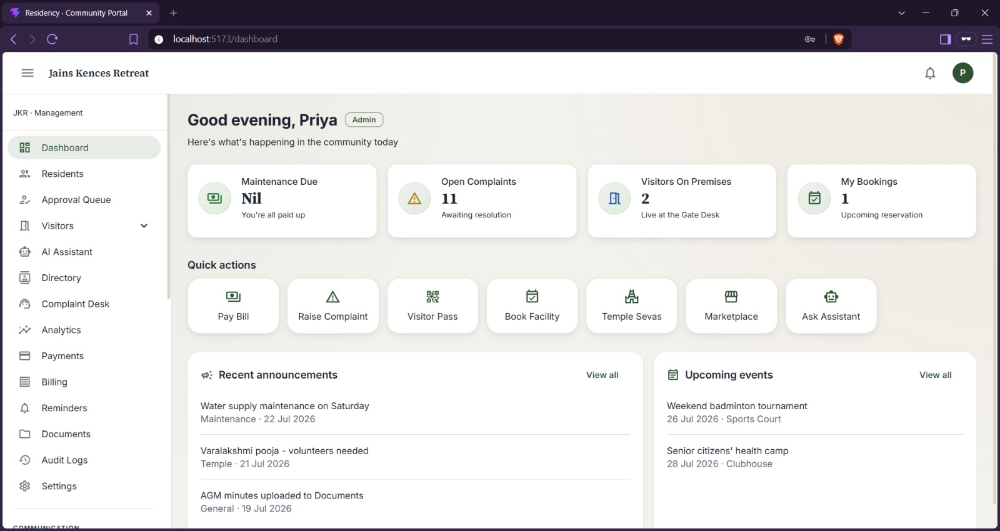
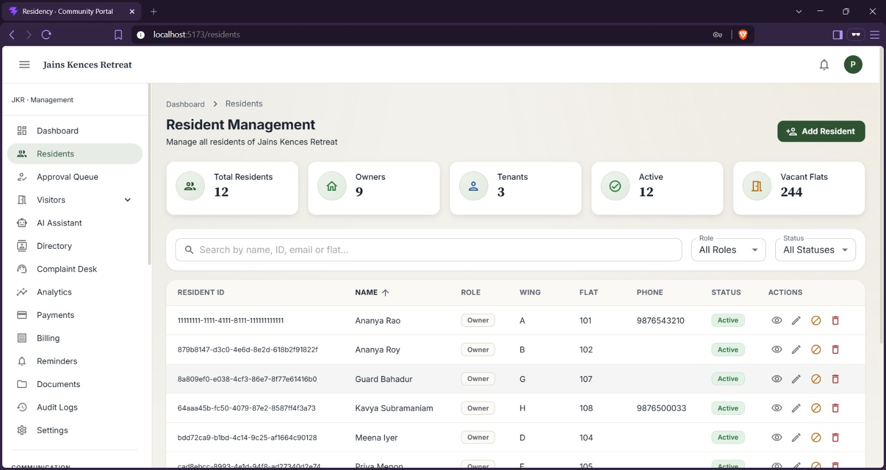
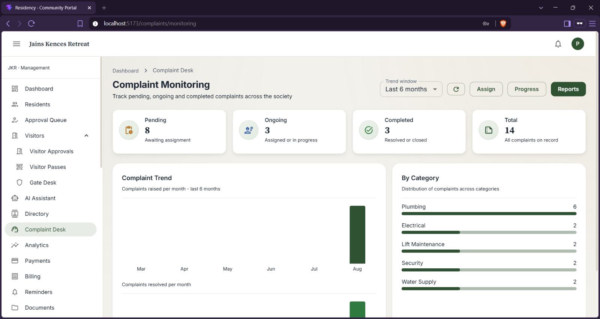
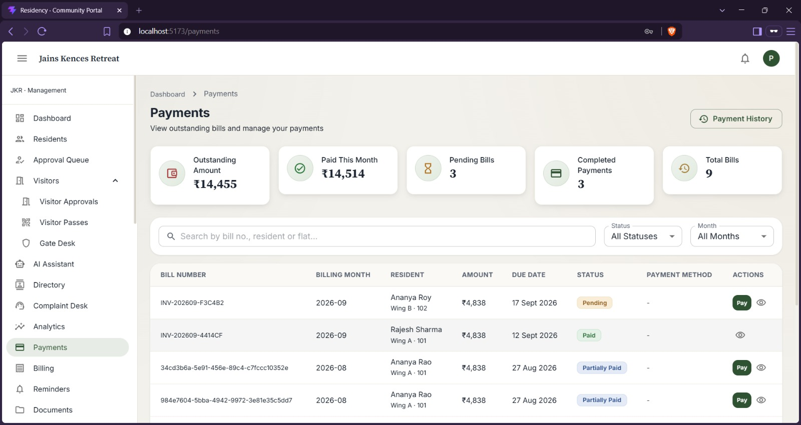
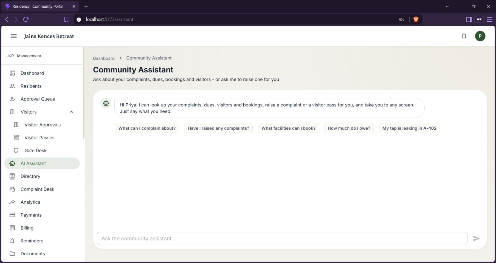

<p align="center">


= 20.19">
</p>

<p align="center">
<a href="#about">About</a> · <a href="#demo">Demo</a> · <a href="#tech-stack">Tech stack</a> · <a href="#getting-started">Getting started</a> · <a href="#logging-in">Logging in</a> · <a href="#modules">Modules</a> · <a href="#the-ai-assistant">AI assistant</a> · <a href="#project-structure">Structure</a> · <a href="#contributors">Contributors</a>
</p>

* * *

## About

A full-stack society management app built for the **Community Services Platform** project (Team 71) for Jains Kences Retreat. It covers everything a residential society needs day to day: complaints, visitor entry, maintenance, billing, community life (temple, marketplace, events, forum, corners), payments, and an AI assistant that actually does things.

The frontend talks to a **live FastAPI backend**, and both run locally. Mock data is kept as an offline fallback, so if the backend is unreachable the pages degrade gracefully instead of breaking.

<table>
<tr>
<td width="25%" align="center"><b>42</b><br><sub>backend stories</sub></td>
<td width="25%" align="center"><b>199</b><br><sub>API endpoints</sub></td>
<td width="25%" align="center"><b>1,720</b><br><sub>automated tests</sub></td>
<td width="25%" align="center"><b>7</b><br><sub>user roles (RBAC)</sub></td>
</tr>
</table>

<table>
<tr>
<td width="33%" valign="top">
<b>Role-aware</b><br>
Seven roles with RBAC. The sidebar and screens change depending on who is logged in.
</td>
<td width="33%" valign="top">
<b>Live and resilient</b><br>
Real API integration with automatic mock-data fallback when offline.
</td>
<td width="33%" valign="top">
<b>Assistant that acts</b><br>
Answers from live records and files complaints, passes and bookings, always after you confirm.
</td>
</tr>
</table>

* * *

## Demo

<table>
<tr>
<td width="33%" valign="top">
<a href="docs/screenshots/01-dashboard.jpg"></a>
<p align="center"><sub><b>Dashboard</b></sub></p>
</td>
<td width="33%" valign="top">
<a href="docs/screenshots/02-resident-management.jpg"></a>
<p align="center"><sub><b>Residents</b></sub></p>
</td>
<td width="33%" valign="top">
<a href="docs/screenshots/05-complaint-monitoring.jpg"></a>
<p align="center"><sub><b>Complaints</b></sub></p>
</td>
</tr>
<tr>
<td width="33%" valign="top">
<a href="docs/screenshots/06-payments.jpg"></a>
<p align="center"><sub><b>Payments</b></sub></p>
</td>
<td width="33%" valign="top">
<a href="docs/screenshots/15-ai-assistant.jpg"></a>
<p align="center"><sub><b>AI assistant</b></sub></p>
</td>
<td width="33%"></td>
</tr>
</table>

<p align="center"><sub>Click any screenshot to view it full size.</sub></p>

* * *

## Tech stack

| | |
| --- | --- |
| **Frontend** |      |
| **Backend** |     |
| **Quality** |   |

> No TypeScript and no state management library. Just React context for auth, onboarding, residents and complaints, and local component state everywhere else.

* * *

## Getting started

### Backend

```bash
cd backend
python3 -m venv venv && source venv/bin/activate   # Windows: venv\Scripts\activate
pip install -r requirements.txt
cp .env.example .env                                # optional; sensible defaults without it
uvicorn app.main:app --reload
```

Runs on `http://localhost:8000`, with Swagger docs at `http://localhost:8000/docs`.

The frontend expects the backend at `http://localhost:8000/api/v1` by default. This is set in `apartment-app/.env`:

```
VITE_API_BASE_URL=http://localhost:8000/api/v1
```

### Frontend

> [!IMPORTANT]
> **You need Node >= 20.19.** Vite 8's native bindings silently fail on older versions. You won't get a helpful error, `npm run dev` just won't start. If you're on an older Node via nvm, run `nvm use 24` (or any Node >= 20.19 / >= 22.12).

Then from `apartment-app/`:

```bash
npm install
npm run dev
```

The dev server runs on `http://localhost:5173`. Other scripts:

| Command | What it does |
| --- | --- |
| `npm run build` | Production build, output to `dist/` |
| `npm run preview` | Preview the production build locally |
| `npm run lint` | Run oxlint |

### Running tests

```bash
cd backend
pytest
```

* * *

## Logging in

Auth is mocked on the frontend. Pick any account below with the password `password123`. The app is role-gated (RBAC), so different accounts see different things in the sidebar.

| Email | Role |
| --- | --- |
| `owner@jkr.com` | Owner |
| `tenant@jkr.com` | Tenant |
| `president@jkr.com` | Association President |
| `secretary@jkr.com` | Association Secretary |
| `admin@jkr.com` | Apartment Manager |
| `maintenance@jkr.com` | Maintenance Staff |
| `security@jkr.com` | Security Guard |

> [!TIP]
> Try it as both a resident (`owner@jkr.com`) and as management (`admin@jkr.com` or `president@jkr.com`). A lot of screens look completely different depending on who is logged in.

* * *

## Modules

| Module | Covers |
| --- | --- |
| `auth` | Login, sign-up, forgot/change password, profile, RBAC |
| `onboarding` | Owner/tenant registration, document upload, KYC, approval queue |
| `residents` | Resident records, add/edit, search |
| `directory` | Owner/tenant/flat directory with search and filters |
| `visitors` | Visitor approvals, guest passes with QR codes, gate verification, entry/exit logs |
| `complaints` | Raise, track, assign, resolve complaints; feedback and ratings |
| `maintenance` | Work orders, preventive maintenance calendar, asset history |
| `workforce` | House-help directory, service providers, attendance and ratings |
| `staffing` | Staff roster and attendance (management-only) |
| `facilities` | Book the gym/pool/court, availability calendar, my bookings |
| `temple` | Seva bookings, donations, temple events (live API) |
| `marketplace` | Buy and sell within the community, wishlist (live API) |
| `communication` | Announcements, emergency alerts, forum, events, community corners |
| `payments` / `billing` | Pay bills, view invoices, payment history, reminders (live API) |
| `documents` | Society documents (rules, AGM minutes, certificates) |
| `reports` | Analytics dashboard for management |
| `audit` | Login/activity logs |
| `settings` | Profile, notification and apartment settings |
| `dashboard` | Landing page after login: quick stats, quick actions, recent announcements/events |
| `assistant` | AI community assistant (see below) |
| `home` | Public landing page shown before login |

<details>
<summary><b>API service layer</b></summary>

<br>

All backend communication goes through `src/services/`. Each file maps to a backend domain and handles snake_case to camelCase translation, so pages never deal with raw API shapes.

| Service file | Backend endpoints |
| --- | --- |
| `paymentService.js` | `/bills`, `/payments` |
| `reminderService.js` | `/reminders` |
| `forumService.js` | `/forum/posts`, `/forum/posts/{id}/comments` |
| `marketplaceService.js` | `/marketplace/listings`, `/marketplace/residents/{id}/wishlist` |
| `eventsService.js` | `/events`, `/events/{id}/register` |
| `templeService.js` | `/temple/sevas`, `/temple/donations`, `/temple/events` |
| `communityService.js` | `/community/activities`, `/community/activities/{id}/signup` |
| `residentService.js` | `/residents` |

Every service call falls back to mock data if the backend is unreachable (NetworkError), so the app stays usable standalone.

</details>

* * *

## The AI assistant

Find it under **AI Assistant** in the sidebar (`/assistant`). It reads and writes real data through the API. It is not a scripted demo.

| What it does | Example |
| --- | --- |
| **Answers from live records** | "Have I raised any complaints?", "How many flats are there?", "What's outstanding on my bills?" The figures come from the database at the moment you ask. |
| **Acts, with your confirmation** | "The tap in A-402 is leaking" proposes a complaint; confirming files it and returns a real reference. Same for visitor passes and facility bookings. It never writes anything without an explicit confirm. |
| **Holds a short conversation** | Say "there's no water" and it asks where; reply "A-402" and it completes the request rather than starting over. |
| **Takes you places** | "Take me to my complaints" navigates. |

<details>
<summary><b>How the understanding works</b></summary>

<br>

Messages are interpreted by a model when one is configured, and by a deterministic keyword engine when one is not. Both feed the same machinery underneath, and the model's answer is treated as a suggestion rather than a decision:

- It may only choose from a catalogue built at runtime from the tool registry, filtered to the caller's role. A resident is never offered an admin tool.
- Values it supplies are validated against what the database accepts, so an invented complaint category is dropped rather than stored.
- It cannot execute anything. Role checks, missing-detail prompts and the confirmation step all sit downstream.

Those properties are covered by tests in `tests/test_be42_assistant.py`, including one asserting that a model returning arbitrary text cannot change which action is taken.

</details>

<details>
<summary><b>Looking things up</b></summary>

<br>

Beyond the curated actions, the assistant can read from the rest of the API. `app/services/assistant_reads.py` builds a catalogue of readable topics from the application's own `GET` routes, so a new endpoint becomes answerable without anyone writing an intent for it. Those reads go back through HTTP with a token minted for the signed-in user, so each endpoint applies its own permissions: the assistant sees exactly what that user would see.

Only `GET` routes are exposed this way. Writes stay curated and confirmed.

</details>

<details>
<summary><b>The analytics layer</b></summary>

<br>

`aiml.py` computes trend, anomalies and forecasts from the real series, and `analytics_service.build_insight()` assembles them. **A model never produces a number.** When one is configured it only rewords a summary sentence that was already calculated, and any failure falls back to the template. That is why the figures on the analytics screen can be trusted whether or not a key is set.

</details>

<details>
<summary><b>Turning a model on</b></summary>

<br>

Entirely optional; see the AI block in `backend/.env.example`. Google AI Studio's free tier works and speaks the OpenAI protocol, so no SDK is needed. Without it the assistant still runs, using the deterministic engine.

> [!NOTE]
> Two things to expect on a free tier: replies take a couple of seconds, and hammering it returns HTTP 429, at which point the assistant quietly falls back to the keyword engine. An answer that worked a moment ago may suddenly look less clever.

</details>

* * *

## Project structure

```
apartment-app/src/
  components/    shared UI: cards, common controls (dialogs, search, empty states), layout (navbar/sidebar)
  config/        app + theme config
  constants/     role definitions used across the app
  context/       app-wide state: auth, onboarding, residents, complaints
  features/      one folder per module
  hooks/         useAuth, useToast
  layouts/       auth layout + the main dashboard shell (sidebar + navbar)
  routes/        route table, ProtectedRoute, RoleRoute
  services/      API service layer, one file per backend domain
  utils/         formatting (currency/date) and form validators

backend/
  app/
    routers/     one router per feature (complaints, billing, payments, etc.)
    models/      SQLAlchemy ORM models
    schemas/     Pydantic request/response schemas
    crud/        database operations
    services/    business logic
  tests/         pytest test suite
  docs/          OpenAPI/Swagger YAML specs per feature
```

Each `features/<name>/` folder is self-contained: `pages/` for routed screens, `components/` for anything reused within that feature, `mock/` for offline fallback data, and a small `index.js` barrel export.

### Good to know

- The backend uses SQLite, so there is no database setup. It creates `backend/apartment.db` on first run.
- Mock data in `features/*/mock/` is kept as offline fallback, not removed. Pages show a warning chip when running on mock data.
- The sidebar is role-aware: items you don't have access to are hidden rather than shown-then-redirecting.
- The layout is responsive; the sidebar becomes an overlay drawer below the `md` breakpoint.
- Data created via the UI (bookings, posts, payments, etc.) persists to the backend database when the backend is running. Without the backend, it only lasts until page refresh.

* * *

## Contributors

This was a group project. Thanks to everyone who built it:

<table>
<tr>
<td align="center"><a href="https://github.com/ekxnsh22005"><br><sub><b>ekxnsh22005</b></sub></a></td>
<td align="center"><a href="https://github.com/MokshadaN"><br><sub><b>MokshadaN</b></sub></a></td>
<td align="center"><a href="https://github.com/smritis21"><br><sub><b>smritis21</b></sub></a></td>
<td align="center"><a href="https://github.com/Saharshjain78"><br><sub><b>Saharshjain78</b></sub></a></td>
<td align="center"><a href="https://github.com/morningstar0521"><br><sub><b>morningstar0521</b></sub></a></td>
</tr>
</table>
