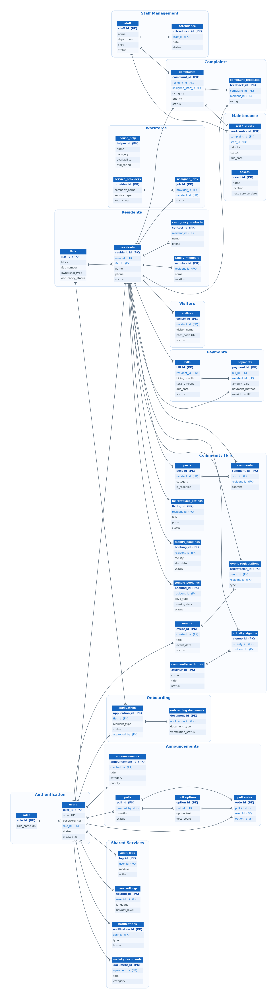

# Entity-Relationship Diagram

## Apartment Association Management System
**Project:** Jains Kences Retreat · Data Model v1

---

# 1. Introduction

This document presents the Entity-Relationship (ER) diagram for the Apartment Association Management System. It is the visual counterpart to `database-schema.md` — every entity, key, and relationship shown here maps directly to a table defined in that schema.

The diagram covers all **37 tables** grouped by the **16 functional modules** described in `system-components.md`. It is intended to be read alongside the schema (field-level detail) and `module-interactions.md` (runtime data flow).

The database is planned in **PostgreSQL**.

---

# 2. Notation

The diagram uses crow's-foot notation:

| Symbol | Meaning |
|--------|---------|
| `PK` (dark blue, bold) | Primary key |
| `FK` (blue) | Foreign key |
| `UK` | Unique constraint |
| Single bar `─┤` | "one" side of a relationship |
| Crow's foot `─<` | "many" side of a relationship |

Each entity box lists its primary key first, followed by the foreign keys and the most significant business columns. Full field lists, types, and constraints are in `database-schema.md`. Entities are grouped into labelled module clusters that mirror the component architecture.

---

# 3. ER Diagram

**Figure 3.1: Entity-Relationship Diagram of the Apartment Association Management System**

---

# 4. Entities by Module

| Module | Entities |
|--------|----------|
| Authentication | users, roles |
| Residents | residents, flats, family_members, emergency_contacts |
| Onboarding | applications, onboarding_documents |
| Complaints | complaints, complaint_feedback |
| Maintenance | work_orders, assets |
| Visitors | visitors |
| Workforce | house_help, service_providers, assigned_jobs |
| Announcements & Communication | announcements, polls, poll_options, poll_votes |
| Payments & Billing | bills, payments |
| Community Hub | posts, comments, events, event_registrations, marketplace_listings, facility_bookings, temple_bookings, community_activities, activity_signups |
| Staff Management | staff, attendance |
| Shared Services | notifications, society_documents, audit_logs, user_settings |

**Total:** 37 tables across 16 modules.

---

# 5. Key Relationships

The `users` and `residents` entities are the two hubs of the model. Almost every operational record links back to one of them.

| Parent | Child | Cardinality | Meaning |
|--------|-------|-------------|---------|
| roles | users | 1 : N | A role is assigned to many users |
| users | residents | 1 : 1 | Each login account maps to one resident profile |
| flats | residents | 1 : N | A flat houses one or more residents |
| residents | family_members | 1 : N | A resident registers family members |
| residents | emergency_contacts | 1 : N | A resident lists emergency contacts |
| flats | applications | 1 : N | Applications are raised against a flat |
| users | applications | 1 : N | An admin approves many applications |
| applications | onboarding_documents | 1 : N | Each application carries KYC documents |
| residents | complaints | 1 : N | A resident raises many complaints |
| staff | complaints | 1 : N | A staff member is assigned many complaints |
| complaints | complaint_feedback | 1 : 1 | Feedback is given on a resolved complaint |
| complaints | work_orders | 1 : 1 | A complaint spawns a reactive work order |
| staff | work_orders | 1 : N | A staff member executes many work orders |
| residents | visitors | 1 : N | A resident issues many visitor passes |
| service_providers | assigned_jobs | 1 : N | A provider takes on many jobs |
| polls | poll_options | 1 : N | A poll has multiple options |
| polls / poll_options / users | poll_votes | 1 : N | One vote per user per poll |
| residents | bills | 1 : N | A resident receives monthly bills |
| bills | payments | 1 : 1 | Each bill is settled by one payment |
| events | event_registrations | 1 : N | Residents RSVP / volunteer for events |
| community_activities | activity_signups | 1 : N | Residents sign up for corner activities |
| staff | attendance | 1 : N | Daily attendance per staff member |
| users | notifications / audit_logs / society_documents | 1 : N | User-scoped shared-service records |
| users | user_settings | 1 : 1 | One preference record per user |

---

# 6. Design Notes

- **Two anchor entities.** `users` anchors authentication and all admin-authored records (announcements, polls, documents, audit logs); `residents` anchors all resident-generated activity (complaints, bills, bookings, posts).
- **No duplicated resident data.** Every module references `residents.resident_id` rather than storing resident details locally — consistent with the single-source-of-truth principle in `system-components.md`.
- **Reports & Analytics has no entity.** It derives all metrics from existing tables and therefore does not appear in the diagram.
- **Community Hub is intentionally wide.** It is a collection of independent features, so it is modelled as nine separate entities rather than one.
- **`audit_logs` is immutable.** It records actions across all modules but is never updated or deleted.

---

# 7. Conclusion

This ER diagram provides the authoritative visual model of the system's data layer. It is fully traceable: every entity corresponds to a table in `database-schema.md`, every table belongs to a module in `system-components.md`, and every relationship supports a workflow in `module-interactions.md`. Together these four artifacts form the complete data specification for the Apartment Association Management System.
