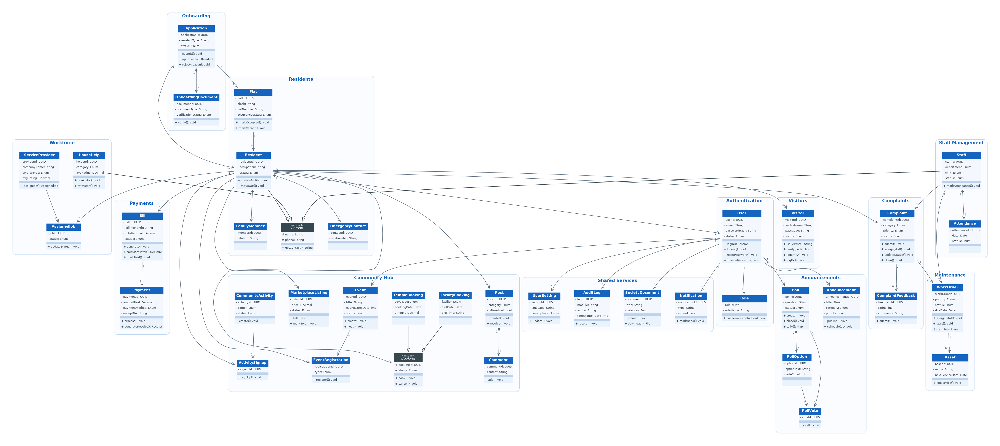

# Class Diagram

## Community Services Platform – Apartment Association Management System
**Project:** Apartment Association Management System for Jains Kences Retreat

---

# 1. Introduction

This document presents the UML class diagram for the Apartment Association Management System. It models the system's **domain classes** — their attributes, key methods, and object-oriented relationships (inheritance, composition, and association).

The class diagram is the object-oriented view of the same domain captured structurally in the ER diagram (`docs/database/er-diagram.md`). Where the ER diagram shows tables and foreign keys, this diagram shows classes, behaviour, and the generalisation and composition relationships between them. Classes are grouped into the same **16 modules** defined in `system-components.md`.

---

# 2. Notation

Standard UML class notation is used:

| Element | Meaning |
|---------|---------|
| Three-compartment box | Class name / attributes / methods |
| `+` | public member |
| `-` | private member |
| `#` | protected member |
| *Italic name* + «abstract» | Abstract class |
| Hollow triangle `△` | Generalisation (inheritance) |
| Filled diamond `◆` | Composition (part cannot exist without the whole) |
| Plain arrow `→` | Association (with multiplicities, e.g. `1`, `*`, `0..1`) |

---

# 3. Class Diagram

**Figure 3.1: UML Class Diagram of the Community Services Platform**

---

# 4. Classes by Module

| Module | Classes |
|--------|---------|
| Authentication | User, Role |
| Residents | Person *(abstract)*, Resident, Flat, FamilyMember, EmergencyContact |
| Onboarding | Application, OnboardingDocument |
| Complaints | Complaint, ComplaintFeedback |
| Maintenance | WorkOrder, Asset |
| Visitors | Visitor |
| Workforce | HouseHelp, ServiceProvider, AssignedJob |
| Announcements | Announcement, Poll, PollOption, PollVote |
| Payments | Bill, Payment |
| Community Hub | Post, Comment, Event, EventRegistration, MarketplaceListing, Booking *(abstract)*, FacilityBooking, TempleBooking, CommunityActivity, ActivitySignup |
| Staff Management | Staff, Attendance |
| Shared Services | Notification, SocietyDocument, AuditLog, UserSetting |

---

# 5. Object-Oriented Relationships

## 5.1 Generalisation (Inheritance)

- **`Person`** *(abstract)* → `Resident`, `Staff`, `HouseHelp`
  Common identity attributes (`name`, `phone`) and `getContact()` are factored into a shared base class. Each subclass adds its own role-specific state and behaviour.
- **`Booking`** *(abstract)* → `FacilityBooking`, `TempleBooking`
  Both booking types share `bookingId`, `status`, `book()`, and `cancel()`, and specialise slot/seva details. This lets the Community Hub treat all bookings uniformly while enforcing type-specific conflict rules.

## 5.2 Composition

Parts that cannot exist without their owner are modelled as composition:

| Whole | Part | Meaning |
|-------|------|---------|
| Resident | FamilyMember, EmergencyContact | Deleted with the resident |
| Application | OnboardingDocument | Documents belong to one application |
| Poll | PollOption | Options exist only within their poll |
| Post | Comment | Comments belong to their post |
| Staff | Attendance | Attendance rows belong to one staff member |

## 5.3 Key Associations

| From | To | Multiplicity | Meaning |
|------|----|--------------|---------|
| User | Role | * : 1 | Every user holds one role |
| User | UserSetting | 1 : 1 | One preference record per user |
| Resident | User | 1 : 1 | Resident profile links to a login account |
| Flat | Resident | 1 : * | A flat houses residents |
| Resident | Complaint / Bill / Visitor / Post | 1 : * | Resident-generated records |
| Staff | Complaint / WorkOrder | 1 : * | Assigned work |
| Complaint | WorkOrder | 1 : 0..1 | Reactive work order from a complaint |
| Bill | Payment | 1 : 1 | Each bill is settled by one payment |
| Event | EventRegistration | 1 : * | RSVPs and volunteers |
| ServiceProvider | AssignedJob | 1 : * | Provider job history |

---

# 6. Design Notes

- **Behaviour, not just data.** Unlike the ER diagram, each class exposes the operations it is responsible for — e.g. `Complaint.assign()`, `Bill.calculateTotal()`, `Visitor.verify()`, `Payment.generateReceipt()`. This traces directly to the responsibilities listed in `system-components.md`.
- **Abstraction where it pays off.** `Person` and `Booking` are the only abstract classes; they remove real duplication (contact details, booking lifecycle) without over-engineering the model.
- **User vs Resident split.** `User` handles authentication and authorisation; `Resident` handles society membership. Keeping them separate mirrors the schema (`users` ↔ `residents`) and supports non-resident accounts such as staff and guards.
- **Reports & Analytics has no class.** Consistent with the schema and components, it is a read-only aggregator over other classes and holds no state of its own.

---

# 7. Conclusion

This class diagram provides the object-oriented specification of the system's domain. It is fully consistent with the ER diagram and the component architecture: every class maps to an entity in `er-diagram.md`, every module grouping matches `system-components.md`, and every method supports a responsibility already documented for that module. Read together, the class diagram (behaviour), the ER diagram (data), and the module-interaction diagrams (flow) form the complete design model for the Apartment Association Management System.
