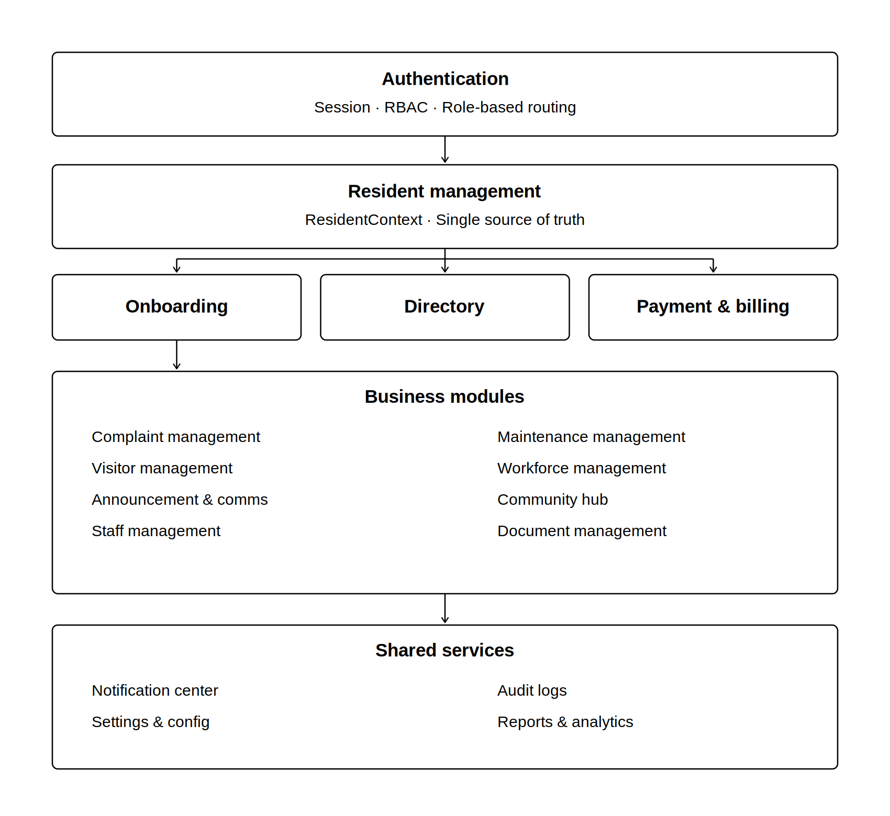

# Module Interactions

## Community Services Platform – Apartment Association Management System
**Project:** Apartment Association Management System for Jains Kences Retreat

---

# 1. Introduction

This document describes how the 16 system modules communicate with each other during real user workflows. It is not a repetition of the component architecture — it focuses specifically on the sequence of module involvement when a user performs an action.

Each workflow answers the question: **User performs action → which modules are involved, in what order, and what does each module do?**

---

# 2. Interaction Principles

- **Authentication is always first.** Every workflow begins with the Authentication module validating the user's session and role before any other module is accessed.
- **ResidentContext is the shared data layer.** Modules do not pass resident data to each other directly. They all read from the same ResidentContext, which is populated once on login.
- **Notifications are always last.** Any workflow that generates an alert ends by passing the event to the Notification Center. Notifications are a consumer of other modules, never a trigger.
- **Audit Logs are passive.** The Audit module listens to key actions across all modules and records them automatically. No module explicitly calls the Audit module — it observes.
- **Reports are read-only aggregators.** The Reports module reads data from operational modules but never writes back to them.
- **No circular dependencies.** Module A may depend on Module B, but Module B never depends back on Module A.

---

# 3. Authentication Workflow

**Trigger:** User opens the application and attempts to log in.

```
User
  ↓
Authentication Module
  — Validates credentials (email + password)
  — Assigns role from user record
  — Creates session token
  ↓
RBAC (Role-Based Access Control)
  — Determines accessible routes based on role
  — Blocks unauthorized route access at ProtectedRoute level
  ↓
ResidentContext
  — Loads resident profile linked to authenticated user
  ↓
Dashboard
  — Renders role-appropriate dashboard view
```

**Modules Involved:** Authentication → RBAC → ResidentContext → Dashboard

**Key Interactions:**
- Authentication produces a session that all other modules consume via AuthContext
- RBAC gates every protected route — no module is accessible without a valid session
- Profile changes in Settings feed back into AuthContext on save

---

# 4. Resident Registration Workflow

**Trigger:** A new owner or tenant submits a registration application.

```
New Resident
  ↓
Resident Onboarding Module
  — Captures owner/tenant details, flat, dates
  — Stores application in OnboardingContext
  ↓
Document Management Module
  — Accepts uploaded documents (Aadhaar, sale deed, rental agreement)
  — Validates file type and size
  — Stores document references against the application
  ↓
Approval Workflow (within Onboarding Module)
  — Application appears in Approval Queue for Secretary/President
  — Admin reviews details and documents
  — Admin approves or rejects with reason
  ↓
Resident Management Module
  — On approval: new resident record created in ResidentContext
  — Flat occupancy status updated
  — Resident is now searchable in Directory
  ↓
Notification Center
  — Applicant notified of approval or rejection
  — Secretary notified of new pending applications
```

**Modules Involved:** Onboarding → Document Management → Resident Management → Notification

**Key Interactions:**
- Onboarding feeds directly into Resident Management on approval
- Document Management is a sub-step of Onboarding, not a standalone trigger
- ResidentContext is updated by Resident Management, making the new resident immediately available to Billing, Directory, and all other modules

---

# 5. Complaint Workflow

**Trigger:** A resident raises a maintenance complaint.

```
Resident
  ↓
Complaint Management Module
  — Resident submits complaint (category, description, location, image)
  — Complaint assigned a unique ID and status: Submitted
  ↓
Notification Center
  — Resident receives confirmation notification
  — Admin/President notified of new complaint
  ↓
Complaint Management Module (Admin side)
  — President/Manager assigns complaint to Maintenance Staff
  — Status updated to: Assigned
  ↓
Maintenance Management Module
  — Staff receives assigned work order
  — Staff updates status: In Progress → Resolved
  ↓
Notification Center
  — Resident notified at each status change
  ↓
Complaint Management Module (Feedback)
  — Resident submits rating and comment on resolved complaint
  ↓
Reports & Analytics Module
  — Complaint data aggregated into monthly reports
  — Resolution time, category breakdown, volume trends updated
  ↓
Audit Logs Module
  — Assignment action, status changes, and resolution recorded
```

**Modules Involved:** Complaint → Notification → Maintenance → Notification → Reports → Audit

**Key Interactions:**
- Complaint Management is the initiator; Maintenance Management is the executor
- Notification Center is triggered at every status transition
- Reports reads complaint data passively — it does not participate in the workflow, only aggregates after the fact

---

# 6. Maintenance Workflow

**Trigger:** Manager creates a preventive maintenance work order or a reactive order from a complaint.

```
Apartment Manager
  ↓
Maintenance Management Module
  — Creates work order (description, priority, asset, due date)
  — Assigns to Maintenance Staff
  — Schedules preventive tasks on maintenance calendar
  ↓
Staff Management Module
  — Staff member's workload updated
  — Shift and availability checked
  ↓
Maintenance Management Module
  — Staff updates work order status: In Progress → Completed
  — Asset maintenance history updated
  ↓
Reports & Analytics Module
  — Maintenance completion rates, overdue tasks, asset history aggregated
  ↓
Audit Logs Module
  — Work order creation, assignment, and completion recorded
```

**Modules Involved:** Maintenance → Staff Management → Reports → Audit

**Key Interactions:**
- Maintenance Management and Staff Management are tightly coupled — every work order assignment checks staff availability
- Reactive work orders originate from Complaint Management; preventive ones are created directly by the Manager
- Reports aggregates maintenance data independently of the workflow

---

# 7. Visitor Workflow

**Trigger:** A resident expects a visitor or delivery.

```
Resident
  ↓
Visitor Management Module
  — Resident issues guest pass (name, purpose, time window)
  — Resident logs expected delivery (sender, flat, time)
  — Unique pass code generated
  ↓
Notification Center
  — Resident receives pass confirmation
  ↓
Security Guard
  ↓
Visitor Management Module (Guard side)
  — Guard verifies pass code at entry
  — Guard records entry timestamp
  — Guard records exit timestamp
  ↓
Audit Logs Module
  — Entry and exit events recorded against resident and visitor
  ↓
Notification Center
  — Resident notified when visitor arrives
```

**Modules Involved:** Visitor Management → Notification → Visitor Management (Guard) → Audit → Notification

**Key Interactions:**
- The same Visitor Management module serves two roles: resident (pass issuance) and guard (verification and logging)
- Audit Logs captures every entry/exit event for security traceability
- Notification Center bridges the resident and guard sides of the workflow

---

# 8. Workforce Workflow

**Trigger:** A resident books a house help service or a manager assigns a service provider job.

```
Resident / Secretary
  ↓
Workforce Management Module
  — Resident browses house help directory by category
  — Resident books available slot
  — Availability updated to prevent double-booking
  ↓
Staff Management Module
  — Entry log recorded when house help arrives
  — Attendance marked for the day
  ↓
Workforce Management Module
  — Resident submits star rating and comment after service
  — Worker's average rating recomputed
  ↓
Reports & Analytics Module
  — Service usage, attendance, and ratings aggregated
```

**Modules Involved:** Workforce Management → Staff Management → Reports

**Key Interactions:**
- Workforce Management handles both house help (resident-facing) and service providers (manager-facing)
- Staff Management handles the attendance and entry log side
- Reports reads workforce data for operational analytics

---

# 9. Payment & Billing Workflow

**Trigger:** Association Secretary generates a monthly maintenance bill for a resident.

```
Association Secretary
  ↓
Billing Module
  — Secretary selects resident from ResidentContext
  — Enters charges (maintenance, water, parking, misc, discount)
  — GST auto-calculated at 18%
  — Bill generated with unique ID and status: Pending
  ↓
Notification Center
  — Resident notified of new bill with due date
  ↓
Payment Reminders Module
  — Reminder sent 3 days before due date if unpaid
  — Overdue status applied after due date passes
  ↓
Resident
  ↓
Payment Module
  — Resident views bill with line-item breakdown
  — Resident initiates payment (mock gateway)
  — Payment processed, receipt generated
  — Bill status updated to: Paid
  ↓
Notification Center
  — Resident receives payment confirmation and receipt
  ↓
Reports & Analytics Module
  — Revenue, collection rate, pending amount, monthly trend updated
  ↓
Audit Logs Module
  — Bill generation and payment events recorded
```

**Modules Involved:** Billing → Notification → Reminders → Payment → Notification → Reports → Audit

**Key Interactions:**
- Billing and Payment are sub-modules of the same Payment & Billing component but serve different roles (admin vs resident)
- ResidentContext is the source of resident data for bill generation — no duplicate data
- Notification Center is triggered at bill generation, reminder, and payment confirmation
- Reports aggregates revenue and collection data passively

---

# 10. Community Hub Workflow

**Trigger:** A resident interacts with any Community Hub sub-module.

```
Resident
  ↓
Community Hub Module
  ↓
  ├── Discussion Forum
  │     — Resident creates post under category
  │     — Other residents comment
  │     — Lost & Found posts marked resolved
  │
  ├── Marketplace
  │     — Resident lists product with images and price
  │     — Other residents browse, wishlist, contact seller
  │     — Seller marks item as sold
  │
  ├── Event Management
  │     — Resident views events, RSVPs, volunteers
  │     — President/Secretary creates and hosts events
  │     — Event gallery updated post-event
  │
  ├── Facility Booking
  │     — Resident checks slot availability (gym, pool, court)
  │     — Resident books slot — availability updated
  │     — Resident cancels booking if needed
  │
  ├── Temple Management
  │     — Resident books pooja/seva slot
  │     — Resident donates with receipt
  │     — Volunteer signup for temple events
  │
  └── Community Corners
        — Kids, Senior, Recreational, Social Circle activities
        — Resident signs up for activities
        — Capacity enforced per activity
  ↓
Notification Center
  — Booking confirmations
  — Event reminders
  — New post/comment alerts
  — Temple booking confirmations
```

**Modules Involved:** Community Hub (all sub-modules) → Notification

**Key Interactions:**
- All Community Hub sub-modules are self-contained but share the same Notification Center for outbound alerts
- Facility Booking enforces slot conflicts server-side — no two residents can book the same slot
- Temple Management and Event Management are role-gated for creation (President/Secretary only)

---

# 11. Notification Workflow

**Trigger:** Any module generates an event that requires user awareness.

```
Source Module (any of the following)
  — Complaint status change
  — Visitor arrival
  — Payment due / received
  — Onboarding approval / rejection
  — Facility booking confirmation
  — Event RSVP confirmation
  — Temple booking confirmation
  — Emergency alert broadcast
  — New announcement published
  ↓
Notification Center Module
  — Notification record created with type, message, timestamp, user
  — Unread count incremented in navbar badge
  ↓
User
  — Opens Notification Center
  — Views categorized notification list
  — Marks as read (single or all)
  — Filters by category
```

**Modules Involved:** All source modules → Notification Center → User

**Key Interactions:**
- Notification Center is a passive consumer — it never initiates a workflow, only receives events
- Every module that generates a user-facing event is responsible for creating a notification record
- User preferences (from Settings module) determine which categories of notifications are delivered

---

# 12. Reports Workflow

**Trigger:** President or Manager opens the Reports & Analytics dashboard.

```
Association President / Apartment Manager
  ↓
Reports & Analytics Module
  ↓
  ├── Complaint Module  →  volume, category breakdown, resolution time
  ├── Payment Module    →  revenue, collection rate, overdue amounts
  ├── Resident Module   →  occupancy, move-ins, move-outs
  ├── Maintenance Module →  work order completion, overdue tasks
  ├── Visitor Module    →  daily visitor counts, peak times
  ├── Community Module  →  event participation, facility usage
  └── Workforce Module  →  attendance rates, service ratings
  ↓
Reports & Analytics Module
  — Aggregates data across all modules
  — Applies date-range filter
  — Renders KPI cards and charts (bar, pie, line)
  — Exports report as PDF/CSV
```

**Modules Involved:** All operational modules → Reports & Analytics

**Key Interactions:**
- Reports is purely a read-only aggregator — it never writes to any module
- All data is read from the same mock data sources (and later, live API endpoints) that the operational modules use
- Date-range filtering is applied at the Reports layer, not at the source module level

---

# 13. Overall Interaction Summary



| Workflow | Initiating Role | Modules Touched |
|----------|----------------|-----------------|
| Authentication | All users | Auth, RBAC, ResidentContext |
| Resident Registration | New Owner/Tenant | Onboarding, Documents, Resident Mgmt, Notification |
| Complaint | Owner/Tenant | Complaint, Maintenance, Notification, Reports, Audit |
| Maintenance | Apartment Manager | Maintenance, Staff Mgmt, Reports, Audit |
| Visitor | Owner/Tenant, Security Guard | Visitor Mgmt, Notification, Audit |
| Workforce | Owner/Tenant, Secretary | Workforce, Staff Mgmt, Reports |
| Payment & Billing | Secretary, Owner/Tenant | Billing, Payment, Notification, Reports, Audit |
| Community Hub | Owner/Tenant | Community Hub (all sub-modules), Notification |
| Notifications | All modules (source) | Notification Center |
| Reports | President, Manager | Reports, all operational modules (read-only) |

---

*This document should be read alongside `system-components.md` (component responsibilities) and the ER diagram (data model). Together they form the complete design specification for the system.*
