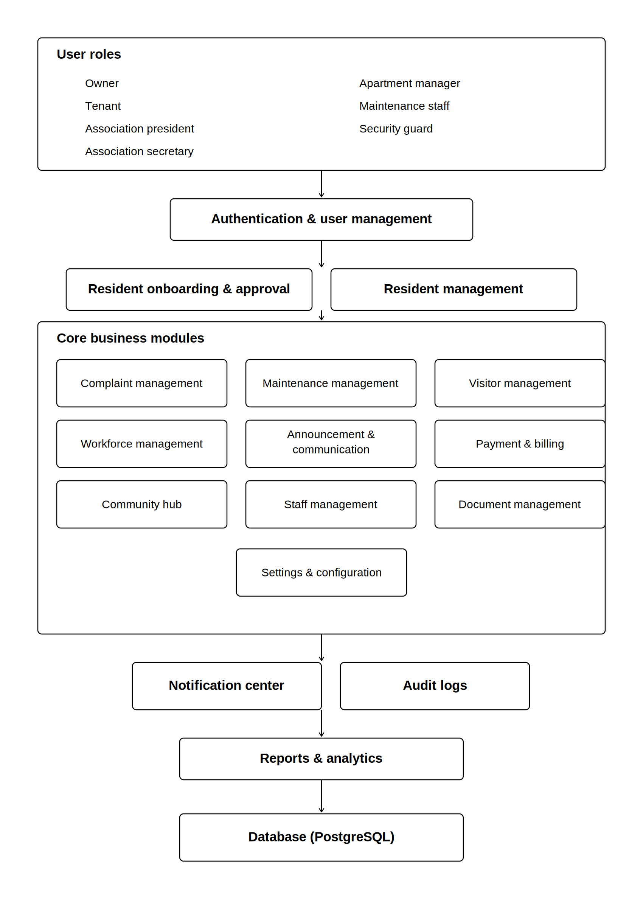

# Design of System Components

## Community Services Platform – Apartment Association Management System
**Project:** Apartment Association Management System for Jains Kences Retreat

---

# 1. Introduction

## 1.1 Overview

The Apartment Association Management System is a centralized web application designed for Jains Kences Retreat, a residential community of over 230 families. Based on stakeholder interviews, pain points, and SMART user stories identified in Milestone 1, the system replaces fragmented workflows — WhatsApp groups, phone calls, notice boards, manual records — with a unified digital platform.

Unlike a conventional apartment management application, this project is designed as a **Community Services Platform**. In addition to complaint handling and maintenance operations, it encourages resident engagement through community events, clubs, discussions, polls, and volunteer initiatives.

The application follows a modular architecture where every major business capability is implemented as an independent component. This improves maintainability, scalability, testing, and future enhancements.

## 1.2 Design Goals

- Modular, feature-first architecture
- Separation of concerns between UI, state, and data
- Role-based access control (RBAC) across all modules
- Centralized shared state via React Context
- Consistent UI design system across all modules
- Community engagement beyond operational management
- Future scalability to mobile and multi-society deployments

---

# 2. System Overview

**Figure 2.1: High-Level Component Architecture of the Community Services Platform**



The system is organized into 16 functional modules. Each module is self-contained with its own components, pages, mock data, and styles. All modules share a common layout, authentication context, resident context, and utility layer.

---

# 3. User Roles

| Role | Description |
|------|-------------|
| Owner | Flat owner residing in the society |
| Tenant | Tenant residing in a rented flat |
| Association President | Elected head of the association, highest admin authority |
| Association Secretary | Manages records, onboarding, and communications |
| Apartment Manager | Oversees maintenance, staff, and operations |
| Maintenance Staff | Executes assigned maintenance work orders |
| Security Guard | Manages visitor entry and verification at the gate |

---

# 4. High-Level Architecture

The frontend is built as a Single Page Application (SPA) using React and Vite. The application is structured as follows:

- **Layouts** — AuthLayout for public pages, DashboardLayout for protected pages
- **Routing** — React Router v6 with protected routes and role-based guards
- **State Management** — React Context API (AuthContext, ResidentContext, AppContext, OnboardingContext)
- **UI Framework** — Material UI (MUI) v5
- **Mock Data** — Static JS files per module simulating backend responses
- **Utilities** — Shared formatCurrency, formatDate, validators

Each feature module follows a consistent internal structure:
```
features/<module>/
  components/   — reusable UI components for the module
  mock/         — static mock data files
  pages/        — full page components registered in AppRoutes
  styles/       — module-specific CSS
  index.js      — barrel exports
```

---

# 5. System Components

---

## 5.1 Authentication & User Management

### Purpose
Provides secure login, registration, password management, profile editing, and role-based access control for all users across the platform.

### Responsibilities
- User login and logout with session management
- New user registration with role assignment
- Forgot password and reset password flows
- Change password with strength validation
- Profile viewing and editing
- Role-based route protection (RBAC)

### Inputs
- User credentials (email, password)
- Registration details (name, role, flat, contact)
- Password reset token

### Outputs
- Authenticated session with role context
- Profile data available across the application
- Access granted or denied based on role

### Dependencies
- AuthContext (session state)
- ResidentContext (profile linkage)

### Accessible Roles
All roles

### Frontend Screens
- Login Page
- Sign Up Page
- Forgot Password Page
- Reset Password Page
- Profile Page
- Change Password Page

### Related User Stories
FE-21, BE-21, EN-21, INT-21

### Future Enhancements
- OTP-based login
- Biometric authentication
- Single Sign-On (SSO)
- Session timeout warnings

---

## 5.2 Resident Onboarding & Approval

### Purpose
Manages the end-to-end process of registering new owners and tenants into the society, including document submission, KYC verification, and association approval.

### Responsibilities
- Owner and tenant registration forms
- Document upload and preview
- KYC verification status tracking
- Association approval queue management
- Approve or reject applications with reason capture
- Move-in and move-out management

### Inputs
- Applicant personal details (name, flat, contact, role)
- Uploaded documents (Aadhaar, sale deed, rental agreement, PAN, photo)
- Approval or rejection decision with reason

### Outputs
- Onboarding application record
- KYC status badge
- Approved resident added to ResidentContext
- Flat occupancy updated on approval

### Dependencies
- ResidentContext (resident creation on approval)
- OnboardingContext (multi-step form state)
- AuthContext (role-gated approval queue)

### Accessible Roles
- Registration: Owner, Tenant (public)
- Approval Queue: Association President, Association Secretary, Apartment Manager

### Frontend Screens
- Registration Type Selection Page
- Owner Registration Page
- Tenant Registration Page
- Document Upload Page
- KYC Verification Page
- Approval Status Page
- Approval Queue Page

### Related User Stories
FE-22, BE-22, EN-22, INT-22

### Future Enhancements
- Automated KYC via Aadhaar API
- Digital signature on agreements
- Move-in slot booking with checklist

---

## 5.3 Resident Management

### Purpose
Provides administrators with a centralized interface to view, add, edit, deactivate, and search all resident records in the society.

### Responsibilities
- Resident list with search and filters
- Add new resident manually
- Edit resident profile and flat details
- Deactivate or mark residents as moved out
- View emergency contacts and family members
- Occupancy status tracking per flat

### Inputs
- Resident profile data (name, wing, flat, role, contact, documents)
- Status updates (active, inactive, moved out)

### Outputs
- Updated resident records in ResidentContext
- Resident detail view with full profile
- Occupancy status reflected in Directory module

### Dependencies
- ResidentContext (single source of truth for all resident data)
- Directory module (reads from same context)
- Billing module (reads residentId for bill generation)

### Accessible Roles
- View: All roles
- Add/Edit/Deactivate: Association Secretary, Association President, Apartment Manager

### Frontend Screens
- Resident Management Page (table, search, filters, add button)
- Resident Detail Page (profile, documents, emergency contacts, tabs)

### Related User Stories
FE-18, BE-18, EN-18, INT-18

### Future Enhancements
- Bulk import via CSV
- Resident self-service profile update
- Family member management

---

## 5.4 Complaint Management

### Purpose
Allows residents to raise, track, and review maintenance complaints while enabling administrators and staff to assign, update, and resolve them.

### Responsibilities
- Complaint submission with category, description, location, image
- Complaint status tracking with timeline
- Complaint assignment to maintenance staff
- Status updates by staff with notes
- Complaint history per resident
- Feedback and rating on resolved complaints
- Complaint analytics for admins

### Inputs
- Complaint details (category, description, location, image)
- Assignment (staff member)
- Status update (in progress, resolved, closed)
- Feedback (rating, comment)

### Outputs
- Complaint record with unique ID
- Status timeline visible to resident
- Notification triggered on status change
- Analytics data for reports

### Dependencies
- AuthContext (resident identity)
- Notification module (status change alerts)
- Reports module (complaint analytics)
- Maintenance Management (staff assignment)

### Accessible Roles
- Submit/Track/History/Feedback: Owner, Tenant
- Assign/Monitor: Association President, Apartment Manager
- Update Status: Maintenance Staff

### Frontend Screens
- Complaint Submission Screen (FE-01)
- Complaint Status Tracking Screen (FE-02)
- Complaint History Screen (FE-10)
- Complaint Assignment Interface — Admin (FE-06)
- Complaint Monitoring Dashboard — Admin (FE-07)
- Complaint Progress Update Screen — Staff (FE-16)
- Feedback & Rating Screen (FE-20)
- Complaint Category Selector (FE-13)
- Complaint Reports Screen (FE-14)

### Related User Stories
FE-01, FE-02, FE-06, FE-07, FE-10, FE-13, FE-14, FE-16, FE-20

### Future Enhancements
- AI-based complaint categorization
- Photo evidence upload
- SLA tracking and breach alerts

---

## 5.5 Maintenance Management

### Purpose
Coordinates all maintenance activities including reactive work orders, preventive maintenance scheduling, asset tracking, and staff workload monitoring.

### Responsibilities
- Work order creation, assignment, and status tracking
- Preventive maintenance scheduling with recurrence
- Maintenance calendar view
- Asset maintenance history
- Staff workload dashboard

### Inputs
- Work order details (description, priority, asset, staff)
- Preventive schedule (date, recurrence, facility)
- Status updates (open, in progress, completed)

### Outputs
- Work order records with audit trail
- Maintenance calendar events
- Asset history per facility
- Staff workload metrics

### Dependencies
- Complaint Management (reactive work orders from complaints)
- Staff Management (staff assignment)
- Reports module (maintenance analytics)

### Accessible Roles
- View: All roles
- Create/Assign/Schedule: Apartment Manager, Association President
- Update: Maintenance Staff

### Frontend Screens
- Work Orders & Maintenance Calendar Screen (FE-24)
- Staff Workload Dashboard (FE-15)
- Maintenance Scheduling Screen (FE-17)

### Related User Stories
FE-15, FE-17, FE-24

### Future Enhancements
- Predictive maintenance via IoT sensors
- QR code scanning for asset identification
- Vendor management integration

---

## 5.6 Visitor Management

### Purpose
Digitizes visitor entry management to improve society security through resident-approved passes, delivery logging, and guard verification.

### Responsibilities
- Resident-issued guest passes with time window
- Delivery entry logging
- Guard verification of pass codes
- Entry and exit logging
- Visitor history with search and filters
- Active on-premise visitor tracking

### Inputs
- Guest pass details (visitor name, purpose, time window)
- Delivery details (sender, flat, expected time)
- Guard verification (pass code scan/entry)

### Outputs
- Guest pass with unique code
- Visitor entry/exit log
- Searchable visitor history
- Active visitor list for security

### Dependencies
- AuthContext (resident and guard identity)
- Notification module (visitor arrival alerts)

### Accessible Roles
- Issue Pass/Log Delivery: Owner, Tenant
- Verify/Log Entry-Exit: Security Guard
- View History: All roles

### Frontend Screens
- Visitor Approval Screen (FE-05)
- Visitor Management Screens (FE-25)

### Related User Stories
FE-05, FE-25

### Future Enhancements
- QR code-based pass verification
- Vehicle entry management
- Integration with intercom systems

---

## 5.7 Workforce Management

### Purpose
Manages house help staff and external service providers — their profiles, bookings, attendance, entry logs, ratings, and job assignments.

### Responsibilities
- House help directory by category (maid, cook, driver, gardener, etc.)
- Booking and availability management
- Entry log and attendance tracking
- Star ratings and feedback after service
- Service provider (plumber, electrician, etc.) job assignment
- Service history per provider

### Inputs
- House help profile (name, category, availability, assigned flats)
- Booking request (resident, date, time)
- Attendance record (present/absent)
- Rating and comment after service
- Service provider job details

### Outputs
- Booking confirmation
- Attendance and entry logs
- Updated average rating per worker
- Service history records

### Dependencies
- ResidentContext (flat and resident linkage)
- Notification module (booking confirmations)

### Accessible Roles
- Book/Rate: Owner, Tenant
- Manage Directory/Jobs: Association Secretary, Apartment Manager

### Frontend Screens
- Workforce Management Screens (FE-26)

### Related User Stories
FE-26

### Future Enhancements
- Background verification integration
- Digital attendance via biometrics
- Service provider marketplace

---

## 5.8 Announcement & Communication

### Purpose
Provides a centralized channel for official communication including announcements, emergency alerts, circulars, meeting notices, polls, and surveys.

### Responsibilities
- Create and publish announcements and circulars
- Emergency alert broadcast to all residents
- Meeting notice creation with agenda
- Poll and survey creation with one-vote enforcement
- Resident view with read indicators
- Poll/survey result visualization

### Inputs
- Announcement details (title, body, category, schedule)
- Emergency alert (title, message)
- Poll options and close date
- Resident vote/response

### Outputs
- Published announcement visible to all residents
- Emergency alert delivered to all users
- Poll results with tally and charts
- Read/unread tracking per resident

### Dependencies
- AuthContext (role-gated creation)
- Notification module (alert delivery)

### Accessible Roles
- Create/Publish: Association President, Association Secretary
- View/Vote: All roles

### Frontend Screens
- Announcements Dashboard (FE-04)
- Announcement Search Screen (FE-09)
- Announcement Creation Screen — Admin (FE-08)
- Emergency Alert Broadcast Screen (FE-19)
- Communication Screens — Polls & Surveys (FE-27)

### Related User Stories
FE-04, FE-08, FE-09, FE-19, FE-27

### Future Enhancements
- Push notification delivery
- Multilingual announcements
- Scheduled publishing

---

## 5.9 Payment & Billing

### Purpose
Handles the complete maintenance fee lifecycle — bill generation by administrators, resident payment, receipt issuance, payment history, and due reminders.

### Sub-modules
- **Billing (FE-28)** — Administrative side: generate bills, view all bills, invoice detail
- **Payments (FE-11)** — Resident side: pay bills, view receipts, payment history

### Responsibilities
- Generate maintenance bills per resident per month
- Auto-calculate GST and grand total
- Bill dashboard with status tracking (paid, pending, overdue, partially paid)
- Online payment with mock gateway
- Digital receipt generation
- Payment history with filters
- Due date reminders
- Late fee calculation

### Inputs
- Bill details (resident, month, maintenance, water, parking, misc, discount, due date)
- Payment details (amount, mode, reference)

### Outputs
- Generated bill with unique ID
- Invoice with line-item breakdown
- Payment receipt
- Updated bill status
- Reminder alerts before due date

### Dependencies
- ResidentContext (resident data for bill generation)
- Notification module (payment reminders)
- Audit module (payment activity logs)

### Accessible Roles
- Generate Bills/View All: Association Secretary, Association President, Apartment Manager
- Pay/View Own Bills/Receipts: Owner, Tenant

### Frontend Screens
- Billing Dashboard Page — stats, table, filters (FE-28)
- Generate Bill Page — form with auto-calculated total (FE-28)
- Invoice Detail Page — breakdown, timeline, receipt (FE-28)
- Online Payment Screen (FE-11)
- Payment Reminders Display (FE-12)
- Payment History Screen (FE-11)
- Receipt Page (FE-11)

### Related User Stories
FE-11, FE-12, FE-28, BE-11, BE-12, BE-28

### Future Enhancements
- Razorpay / UPI gateway integration
- Automated bill generation on schedule
- Statement export as PDF
- Late fee auto-accrual

---

## 5.10 Community Hub

### Purpose
Acts as the social and engagement layer of the platform, encouraging resident participation through forums, marketplace, events, facility booking, temple management, and community corners.

### Sub-modules

#### 5.10.1 Discussion Forum
- General discussion, suggestions, lost & found, local recommendations
- Post creation with comments, category filters, search

#### 5.10.2 Buy & Sell Marketplace
- List products with images, price, category
- Browse with filters, wishlist, mark as sold

#### 5.10.3 Event Management
- Community and festival events with RSVP and volunteer registration
- Event gallery, hosting by permitted roles

#### 5.10.4 Facility Booking
- Gym, swimming pool, sports court slot booking
- Availability calendar, my bookings, cancel option

#### 5.10.5 Temple Management
- Monthly pooja and seva bookings (abhishekam, archana, sandhana kaapu)
- Donation flow with receipt
- Temple events and volunteer signup

#### 5.10.6 Kids Corner
- Competitions, summer camp, sports, hobby clubs, birthday calendar

#### 5.10.7 Senior Citizens Corner
- Health camps, yoga, walking club, bhajan groups, birthday wishes, community support

#### 5.10.8 Recreational Corner
- DIY activities and hobby sessions

#### 5.10.9 Social Circle
- Cleanliness drives, donation campaigns, community initiatives

### Dependencies
- AuthContext (resident identity)
- Notification module (event and booking alerts)

### Accessible Roles
- All residents for participation
- Association President/Secretary for event and temple management

### Frontend Screens
- Discussion Forum Screen (FE-29)
- Marketplace Screen (FE-30)
- Events Screen (FE-31)
- Facility Booking Screen (FE-32)
- Temple Management Screen (FE-33)
- Community Corners Screen (FE-34)

### Related User Stories
FE-29 through FE-34

### Future Enhancements
- Real-time chat in forum
- Payment integration for temple donations and facility booking
- Event photo gallery with upload

---

## 5.11 Staff Management

### Purpose
Manages society staff — maintenance, security, and housekeeping — including shift allocation, attendance marking, and daily coverage monitoring.

### Responsibilities
- Staff roster and shift allocation
- Daily attendance marking (present/absent/leave)
- Shift conflict detection
- Coverage and understaffing alerts
- Staff profile management

### Inputs
- Staff details (name, role, shift)
- Attendance record per day
- Shift allocation (day, time, staff member)

### Outputs
- Daily roster with coverage summary
- Attendance records
- Conflict and understaffing flags

### Dependencies
- Maintenance Management (staff assignment to work orders)
- Workforce Management (house help directory)

### Accessible Roles
- Apartment Manager, Association President

### Frontend Screens
- Staff Attendance & Shift Screen (FE-35)

### Related User Stories
FE-35

### Future Enhancements
- Biometric attendance integration
- Automated shift rotation
- Leave management system

---

## 5.12 Reports & Analytics

### Purpose
Provides administrators with a consolidated analytics dashboard covering complaints, payments, residents, maintenance, visitors, facility usage, and event participation.

### Responsibilities
- Cross-module metric aggregation
- Date-range filtering
- Chart visualization (bar, pie, line)
- Report export (PDF/CSV)
- Dashboard KPI cards

### Inputs
- Date range selection
- Module filter (complaints, payments, etc.)

### Outputs
- Aggregated metrics and trend charts
- Exportable reports
- Dashboard KPI summary

### Dependencies
- All operational modules (reads aggregated data)

### Accessible Roles
- Association President, Apartment Manager

### Frontend Screens
- Reports & Analytics Dashboard (FE-36)
- Complaint Reports Screen (FE-14)

### Related User Stories
FE-14, FE-36

### Future Enhancements
- Scheduled report delivery via email
- Predictive analytics
- Custom report builder

---

## 5.13 Notification Center

### Purpose
Aggregates all system-generated alerts from every module into a single unified notification center for each user.

### Responsibilities
- Aggregate notifications from all modules
- Unread badge count in navbar
- Mark as read (single and all)
- Category filters (complaint, payment, visitor, booking, event, temple, emergency)
- Clear all action

### Inputs
- Events from all modules (status changes, approvals, reminders, alerts)

### Outputs
- Notification list per user with read/unread state
- Unread count in navbar
- Category-filtered view

### Dependencies
- All modules (notification generation source)
- AuthContext (user identity for routing notifications)

### Accessible Roles
All roles

### Frontend Screens
- Notifications Panel (FE-03)
- Notification Center Screen (FE-37)

### Related User Stories
FE-03, FE-37

### Future Enhancements
- Push notifications via Firebase
- Email and SMS delivery
- Notification preferences per category

---

## 5.14 Document Management

### Purpose
Provides a centralized repository for society documents — apartment rules, AGM minutes, circulars, resident documents, and society certificates.

### Responsibilities
- Document listing grouped by category
- Search by title or date
- Download and preview per document
- Admin upload and replace with role-gating
- Access restriction by role

### Inputs
- Document file (PDF, image)
- Document metadata (title, category, date)

### Outputs
- Categorized document list
- Downloadable/previewable document
- Upload confirmation

### Dependencies
- AuthContext (role-based access control)

### Accessible Roles
- View/Download: All roles
- Upload/Replace: Association President, Association Secretary, Apartment Manager

### Frontend Screens
- Document Management Screen (FE-38)

### Related User Stories
FE-38

### Future Enhancements
- Document versioning
- E-signature integration
- Expiry alerts for certificates

---

## 5.15 Audit Logs & Activity History

### Purpose
Maintains an immutable, searchable log of all key actions performed across the system for accountability and traceability.

### Responsibilities
- Log key actions: login, complaint activity, payment activity, visitor activity, booking activity, admin actions
- Filter by activity type, user, and date range
- Display actor, action, target, and timestamp per entry
- Export audit log
- Admin-only access

### Inputs
- System events from all modules (triggered automatically)
- Filter parameters (type, user, date range)

### Outputs
- Immutable audit log entries
- Filtered and paginated log view
- Exportable log

### Dependencies
- All modules (event sources)
- AuthContext (admin-only access guard)

### Accessible Roles
- Association President, Apartment Manager (admin-only)

### Frontend Screens
- Audit Logs Screen (FE-39)
- Login Logs Page
- Activity Logs Page

### Related User Stories
FE-39

### Future Enhancements
- Real-time activity stream
- Anomaly detection alerts
- Compliance report generation

---

## 5.16 Settings & System Configuration

### Purpose
Allows users to manage personal preferences and enables administrators to configure system-wide apartment settings.

### Responsibilities
- Notification preference management per category
- Privacy settings (contact visibility)
- Language selection
- Profile settings
- Apartment configuration (blocks, flat categories, roles) — admin only
- Unsaved-changes guard
- Role-gated admin section

### Inputs
- User preference updates (notifications, privacy, language)
- Admin configuration updates (apartment structure, categories)

### Outputs
- Persisted user preferences applied across the app
- Updated apartment configuration
- Success confirmation on save

### Dependencies
- AuthContext (role-gated admin section)
- All modules (notification preferences affect delivery)

### Accessible Roles
- Profile/Notification/Privacy/Language: All roles
- Apartment Configuration: Association President, Apartment Manager

### Frontend Screens
- System Settings Page (FE-40)
- Profile Settings Page
- Notification Settings Page
- Apartment Config Page

### Related User Stories
FE-40

### Future Enhancements
- Theme customization
- Multi-language support
- Multi-society configuration

---

# 6. Component Dependency Matrix

| Module | Depends On | Used By |
|--------|-----------|---------|
| Authentication | — | All Modules |
| Resident Onboarding | Auth, ResidentContext, OnboardingContext | Resident Management |
| Resident Management | Auth, ResidentContext | Billing, Directory, Complaint |
| Complaint Management | Auth, Resident, Notification, Maintenance | Reports, Audit |
| Maintenance Management | Complaint, Staff Management | Reports, Audit |
| Visitor Management | Auth, Notification | Audit |
| Workforce Management | Auth, ResidentContext, Notification | Audit |
| Announcement & Communication | Auth, Notification | All Residents |
| Payment & Billing | Auth, ResidentContext, Notification | Audit, Reports |
| Community Hub | Auth, Notification | All Residents |
| Staff Management | Auth | Maintenance |
| Reports & Analytics | All Operational Modules | President, Manager |
| Notification Center | All Modules | All Users |
| Document Management | Auth | All Residents |
| Audit Logs | All Modules | President, Manager |
| Settings & Configuration | Auth | All Users |

---

# 7. Technology Stack

| Layer | Technology |
|-------|-----------|
| Frontend Framework | React 18 with Vite |
| UI Component Library | Material UI (MUI) v5 |
| Routing | React Router v6 |
| Form Management | React Hook Form |
| State Management | React Context API |
| Styling | MUI theming + CSS variables |
| Mock Data | Static JS files per module |
| Build Tool | Vite |
| Version Control | Git / GitHub |
| Backend (planned) | Python / FastAPI |
| Database (planned) | PostgreSQL |
| API Documentation (planned) | Swagger / OpenAPI YAML |
| Testing (planned) | pytest |

---

# 8. Design Principles

**Feature-first modular structure** — Every module is self-contained under `features/<module>/` with its own components, pages, mock data, and styles. This prevents cross-module coupling and makes each feature independently testable and deployable.

**Single source of truth via Context** — ResidentContext is the authoritative source for all resident data. Billing, Directory, Onboarding, and Residents all read from the same context instead of duplicating data.

**Consistent UI design system** — Every module reuses the same shared components: PageHeader, DashboardCard, SearchBar, ConfirmationDialog, EmptyState, StatusChips, and BreadCrumbs. This ensures visual and behavioral consistency across the entire application.

**Role-based access at the route level** — ProtectedRoute and RoleRoutes enforce authentication and role permissions before any page renders. Unauthorized access is blocked at the routing layer, not just the UI layer.

**Mock-first development** — All modules are built against static mock data files that mirror the expected API contract. This allows full frontend development and testing without a live backend, and makes the integration sprint (Epic 5) a clean swap of mock data for live API calls.

**Separation of concerns** — Pages handle layout and orchestration. Components handle rendering. Context handles state. Utils handle formatting. Mock files handle data. No layer bleeds into another.

---

# 9. Scalability Considerations

- **Multi-society support** — The apartment configuration module is designed to support multiple societies by parameterizing block names, flat categories, and role structures.
- **Code splitting** — Each feature module can be lazy-loaded via dynamic imports to reduce initial bundle size as the application grows.
- **Context scalability** — As the application grows, individual module contexts (e.g. BillingContext, ComplaintContext) can be introduced without refactoring existing modules.
- **API-ready mock structure** — Every mock data file mirrors the shape of the planned REST API response, making the Epic 5 integration sprint a direct replacement with minimal UI changes.
- **Component reuse** — Shared components like BillStatusChip, ResidentStatusChip, FlatStatusChip follow the same pattern and can be extended to new status types without modifying existing code.
- **Mobile readiness** — All pages use MUI's responsive Grid system and are designed to render correctly on tablet and desktop widths. A React Native port is a planned future enhancement.

---

# 10. Conclusion

The proposed component architecture provides a scalable, modular, and maintainable foundation for the Apartment Association Management System. The 16 modules cover the full spectrum of society management — from authentication and onboarding to billing, community engagement, staff management, and audit logging.

The inclusion of the Community Hub distinguishes this project from conventional apartment management software by encouraging resident participation beyond daily operations. Every component is directly traceable to the user stories in the product backlog (FE-01 through FE-40, BE-01 through BE-40), ensuring consistency between stakeholder requirements, software design, and implementation.

The mock-first frontend architecture ensures that all 40 frontend user stories can be demonstrated and evaluated independently of the backend, while the clean API contract defined by the mock data structure ensures a smooth transition during the integration sprint.
